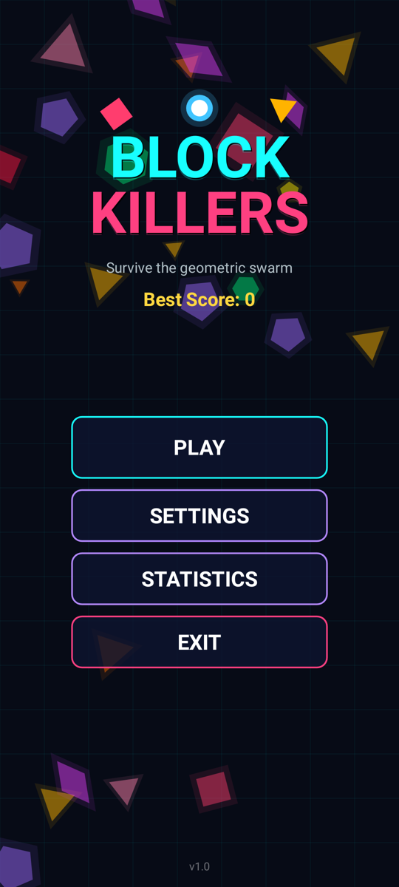
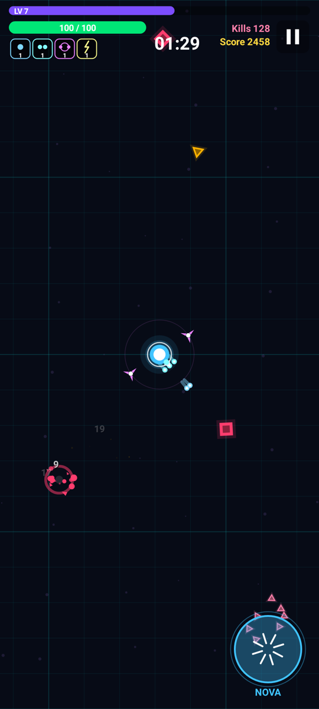
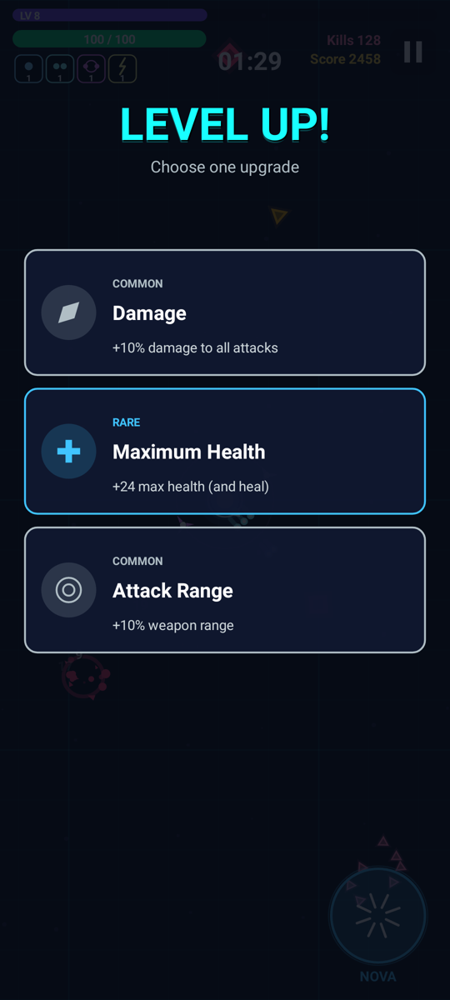
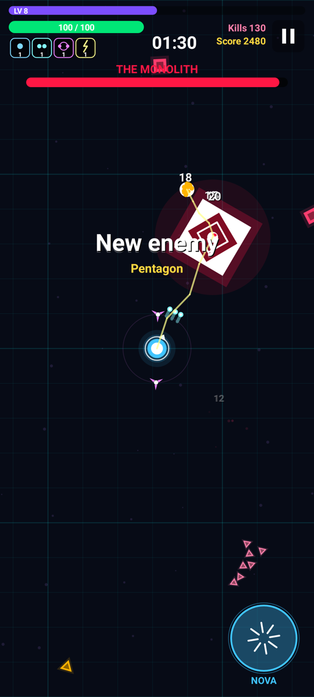
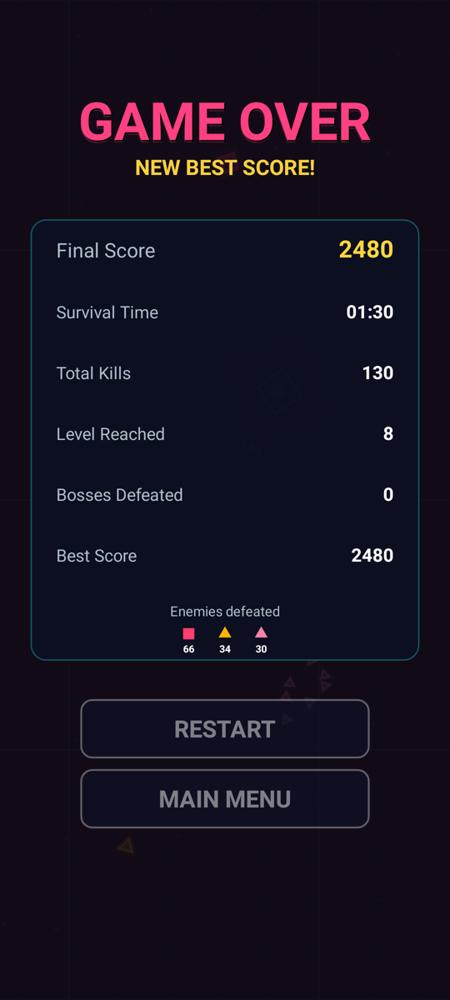

# BLOCK KILLERS

A 2D top-down endless survival arcade game for Android. You are a glowing circle in a neon arena,
surrounded by hostile geometric shapes. Move, auto-fire, level up, pick upgrades, beat bosses and survive.

**APK:** [`release/Block-Killers.apk`](release/Block-Killers.apk) (≈150 KB, Android 7.0+ / API 24–34, works fully offline)

| Menu | Gameplay | Level up | Boss | Game over |
|---|---|---|---|---|
|  |  |  |  |  |

*(Screenshots above were rendered by Android's own Skia canvas through Robolectric, not mock-ups.)*

## Install on your phone
1. Copy `release/Block-Killers.apk` to the phone (or download it there) and tap it.
2. Allow "Install unknown apps" for the app you opened it with (browser / file manager / messenger).
3. If Play Protect warns about an unknown developer, choose **Install anyway**. The app is self-signed, and the only permission it asks for is vibration. It has no internet permission.

## How to play
- **Move:** touch and drag anywhere (a floating joystick appears under your thumb).
- **Attack:** automatic. Every weapon targets the nearest enemy, and focuses the boss when it is in range.
- **NOVA** (bottom-right): an active ability that blasts and pushes back nearby enemies and erases enemy bullets. It has a 14 s cooldown.
- Kills give XP. Each level-up pauses the game and offers 3 upgrade cards (Common / Rare / Epic / Legendary, new weapons, weapon levels).
- New enemy types appear over time: Block, Triangle, Swarm, Pentagon, Diamond, Charger, Hexagon, Splitter, Shooter, Tank.
- **Bosses** arrive at 5:00 and then every 5 minutes: The Monolith (charges and radial bursts), Hex Hive (orbits, spawns minions, spiral fire) and Prism (teleports, shotgun volleys). Beating a boss heals you and grants an Epic+ reward.
- 8 weapons: Blaster, Twin Shot, Tri Shot, Piercer, Rocket, Orbit Blades, Lightning, Pulse. You can hold up to 6, each up to level 6.
- **Score** = enemy values + 2 per second survived + 2,500 × boss tier + 500 per achievement unlocked in the run.
- 12 achievements, each granting a small **permanent bonus** to future runs.
- **Settings:** music volume, SFX volume, control sensitivity, vibration, screen shake, damage numbers, graphics quality (Low/Medium/High), performance (60 FPS / 30 FPS battery saver), language (English / فارسی).

## Rebuild the APK
Requirements: JDK 17+ (tested with 21), `curl`, `unzip`. The Android SDK is installed automatically.

```bash
./build-apk.sh                       # -> release/Block-Killers.apk
ANDROID_HOME=/path/to/sdk ./build-apk.sh   # use an existing SDK
```
`build-apk.sh` runs `aapt2 → javac → d8 → zipalign → apksigner` directly, so it needs no Gradle and no third-party libraries.

**Android Studio / Gradle** also works (AGP 8.7, Gradle 8.9+):
```bash
gradle :app:assembleRelease          # -> app/build/outputs/apk/release/app-release.apk
gradle :app:testDebugUnitTest        # Robolectric tests of the Android layer
```
Both builds sign with `signing/block-killers.jks` (password `blockkillers`). This keystore is committed on purpose so that rebuilt APKs install as updates. It is **not** a secret. Use your own key if you ever publish the game.

## Tests
```bash
tools/run-tests.sh            # 99 automated gameplay checks (headless, ~10 s)
tools/run-tests.sh screens    # renders every screen to docs/screenshots/
tools/run-tests.sh assets     # regenerates launcher icons + splash logo
```
See [docs/TESTING.md](docs/TESTING.md) for the full testing summary and [docs/ARCHITECTURE.md](docs/ARCHITECTURE.md) for the design.

## Project layout
```
app/src/main/java/com/blockkillers/core/     platform-independent game (all gameplay, UI, audio synthesis)
app/src/main/java/com/blockkillers/android/  Android host: Activity, Canvas renderer, SoundPool/AudioTrack, SharedPreferences
app/src/main/res/                            icons (adaptive + PNG), splash, theme
app/src/test/                                Robolectric tests (real Android framework on the JVM)
desktop/src/                                 headless test harness, bot player, Java2D renderer, screenshot + asset generators
build-apk.sh, build.gradle, settings.gradle  build configuration
release/Block-Killers.apk                    the installable game
```
